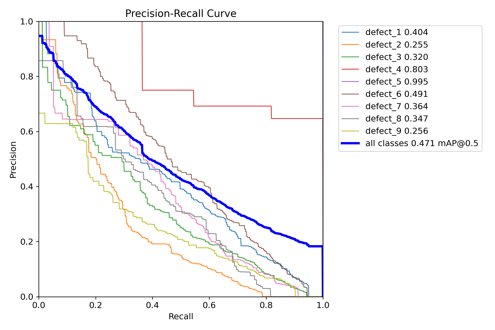
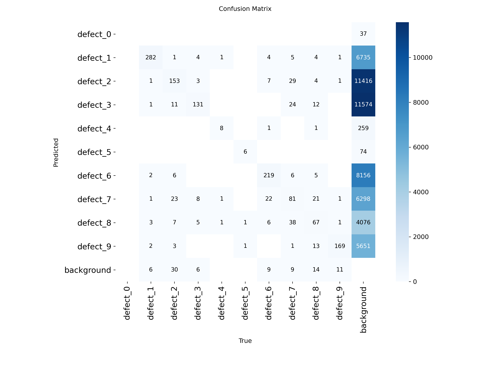
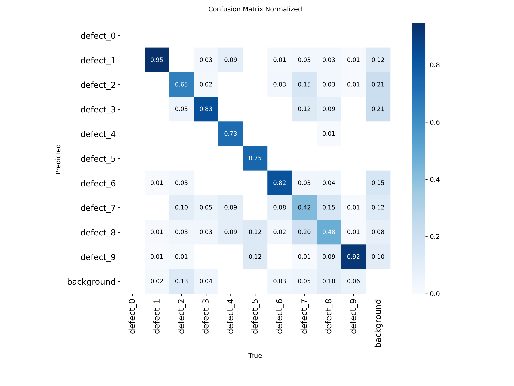

# Railway Defect Detection with YOLOv8

An object detection project for identifying railway track defects using YOLOv8. This project establishes a baseline model, explores an experimental model, visualizes predictions, and evaluates detection performance on validation and test datasets.

## Project Overview

The objective of this project is to explore YOLOv8 for railway defect detection and document baseline model performance.

### Models

- **YOLOv8n** — baseline model.
- **YOLOv8s** — experimental model.

The YOLOv8n model is used for the reported test-set evaluation. YOLOv8s results are reported for the validation set only.

## Dataset

This project uses the **Multi-class defects in railway tracks** dataset.

- **Source:** [Mendeley Data — Multi-class defects in railway tracks](https://data.mendeley.com/datasets/88sh5y3tmj/1)
- **DOI:** [10.17632/88sh5y3tmj.1](https://doi.org/10.17632/88sh5y3tmj.1)
- **Version:** 1
- **License:** [Creative Commons Attribution 4.0 International (CC BY 4.0)](https://creativecommons.org/licenses/by/4.0/)

Please refer to the original dataset record for the dataset authors, recommended citation, attribution requirements, and license terms.

The current model labels are represented as `defect_0` to `defect_9`. Their semantic mapping has not yet been independently verified, so these labels should not be interpreted as specific defect types without further verification.

## Methodology

The project explores object detection using YOLOv8 with two model configurations:

1. **YOLOv8n baseline:** used to establish baseline performance.
2. **YOLOv8s experiment:** used to explore a different model size.

The notebook covers model training, prediction visualization, and evaluation on the available dataset splits.

The reported metrics include precision, recall, mean Average Precision at an IoU threshold of 0.50 (mAP50), and mean Average Precision across IoU thresholds from 0.50 to 0.95 (mAP50-95).

## Experimental Results

### YOLOv8n — Validation Set

| Metric | Result |
|---|---:|
| Precision | 0.4587 |
| Recall | 0.4185 |
| mAP50 | 0.3906 |
| mAP50-95 | 0.1579 |

### YOLOv8s — Validation Set

| Metric | Result |
|---|---:|
| Precision | 0.4523 |
| Recall | 0.4520 |
| mAP50 | 0.3837 |
| mAP50-95 | 0.1556 |

### YOLOv8n — Test Set

The YOLOv8n baseline was evaluated on the test split using the saved `best.pt` checkpoint.

| Metric | Result |
|---|---:|
| Test images | 300 |
| Labeled instances | 1,494 |
| Precision | 0.4886 |
| Recall | 0.5127 |
| mAP50 | 0.4707 |
| mAP50-95 | 0.1858 |

Validation and test results come from different data splits and should not be compared as equivalent evaluations. A YOLOv8s test-set result is not reported here.

## Evaluation Artifacts

Evaluation plots and metrics for the YOLOv8n baseline are available in the [`results/`](results/) directory.

### Precision–Recall Curve

### Confusion Matrix

### Normalized Confusion Matrix

Additional evaluation artifacts include:

- `BoxF1_curve.png` — F1 score curve.
- `BoxP_curve.png` — precision curve.
- `BoxR_curve.png` — recall curve.
- `baseline_metrics.csv` — summary of test-set evaluation metrics.

These artifacts correspond to the YOLOv8n test-set evaluation. The plots and CSV file must be present in the `results/` directory for the links to work.

## Repository Contents

- `railway_defect_detection_yolov8_baseline_clean.ipynb` — organized notebook for the baseline experiment. Confirm that this filename matches the actual notebook in the repository.
- `results/` — evaluation plots and test-set metrics.
- `README.md` — project overview, dataset information, methodology, and results.
- `LICENSE` — license for the project code and notebook.

## Limitations

- The class labels remain generic until their semantic mapping is verified.
- Some classes may have few test instances, which can make per-class metrics unstable.
- The reported metrics describe model performance on the evaluated dataset and do not establish real-world railway inspection reliability.
- The model is an experimental baseline and is not validated for railway safety or operational use.
- Further evaluation, error analysis, and model improvement are needed before practical deployment.
- The YOLOv8s model has validation results reported here, but no test-set result is reported.

## Reproducibility

The notebook currently uses Google Drive paths for the dataset and model weights. These paths must be adapted to the environment where the notebook is run.

To reproduce the experiment:

1. Obtain the dataset from the source linked in the Dataset section and follow its license terms.
2. Open the notebook in Google Colab or a compatible Python environment.
3. Install the required packages, including Ultralytics and PyYAML, using compatible versions.
4. Configure the dataset and model-weight paths for your environment.
5. Run the notebook cells in order.

For improved reproducibility, record the Python and package versions, training configuration, dataset version, random seed where available, and the exact model checkpoint used for evaluation.

## License

The project code and notebook are licensed under the MIT License. See [LICENSE](LICENSE).

Copyright (c) 2026 Adam Mahabayu Muhibbulloh.

The dataset is distributed separately under its own license. Please refer to the original [Mendeley Data record](https://data.mendeley.com/datasets/88sh5y3tmj/1) and the [CC BY 4.0 license](https://creativecommons.org/licenses/by/4.0/) for dataset terms and attribution.
